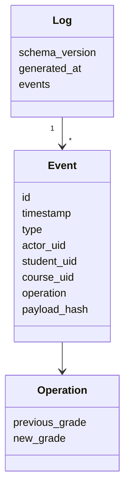
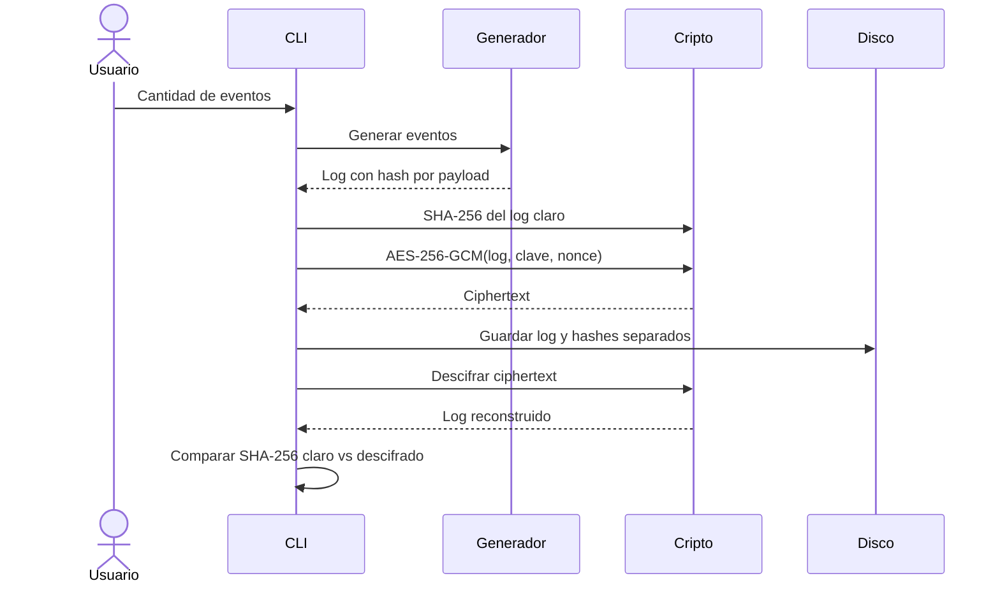

# Taller de Criptografía: protección de logs en reposo

## Ejecución

Requiere Go 1.22 o superior.

```powershell
go mod tidy
go run .
```

La aplicación crea los artefactos dentro de `artifacts/`:

| Artefacto | Propósito |
|---|---|
| `log.json` | Log original en claro |
| `log.sha256` | Hash SHA-256 del log original |
| `log.enc` | Log cifrado; contiene nonce al inicio |
| `log.enc.sha256` | Hash SHA-256 del ciphertext |
| `key.hex` | Clave aleatoria AES-256 usada en esta ejecución |
| `log.decrypted.json` | Resultado del descifrado |
| `log.decrypted.sha256` | Hash del resultado del descifrado |

## Decisiones de diseño

- Cada evento tiene un identificador único, timestamp UTC, tipo de operación,
  actor, estudiante, curso y datos de la nota.
- El `payload_hash` se calcula sobre todos los campos del evento excepto
  `payload_hash` mismo. Así se evita una dependencia circular. Se serializa un
  `payload` explícito con `encoding/json` antes de aplicar SHA-256.
- Las notas se generan uniformemente en el intervalo `[0.000, 5.000]`, en
  incrementos de 0.001. Las modificaciones incluyen `previous_grade` y
  `new_grade`.
- El cifrado usa AES-256-GCM de la biblioteca estándar. GCM ofrece
  confidencialidad y autenticidad del ciphertext; el nonce se genera con
  `crypto/rand` y se almacena como prefijo de `log.enc`.
- La comparación final usa los bytes exactos del JSON serializado antes y
  después del cifrado. Una coincidencia del hash demuestra que el proceso
  preservó el artefacto.
- La clave se guarda separada del log y con permisos restrictivos. En un
  sistema real debería protegerse con un gestor de secretos o HSM, no junto
  al ciphertext.

## Estructura y comportamiento

Estructura:



Flujo:



## Uso responsable de IA

La IA se utilizó como apoyo para organizar el diseño, revisar decisiones de
implementación y proponer pruebas. El equipo debe revisar, comprender, probar
y adaptar todo el código antes de entregarlo; la responsabilidad final de la
solución y de su uso es humana.
